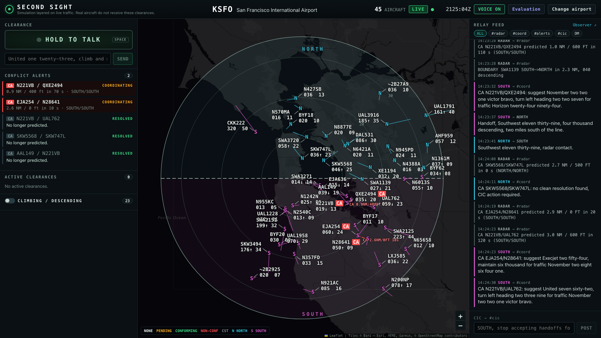
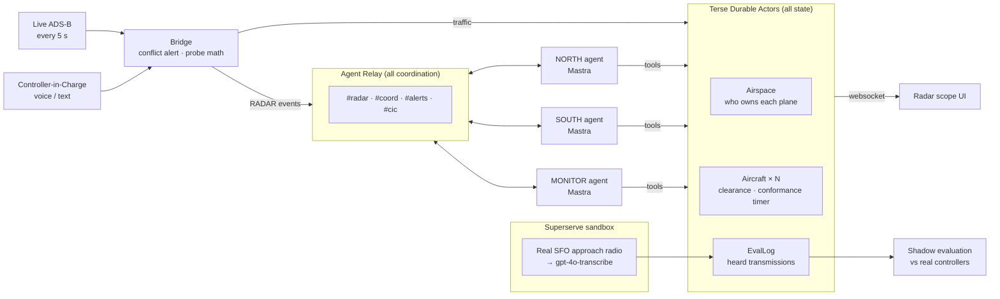
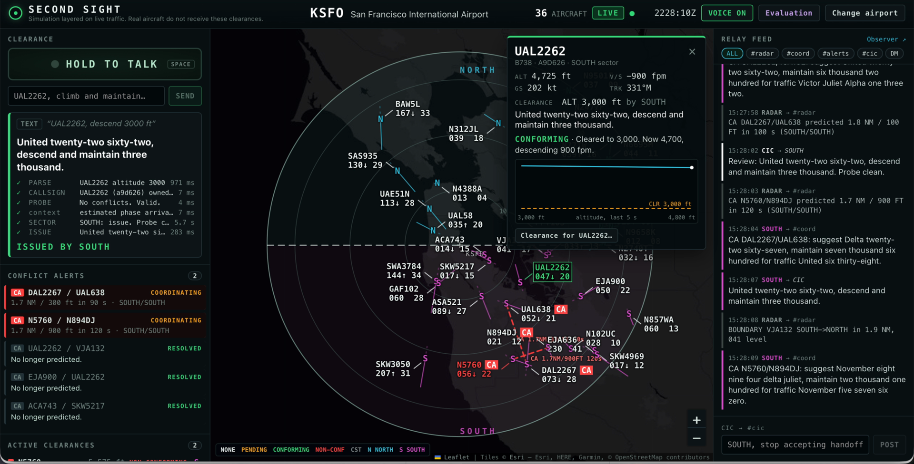
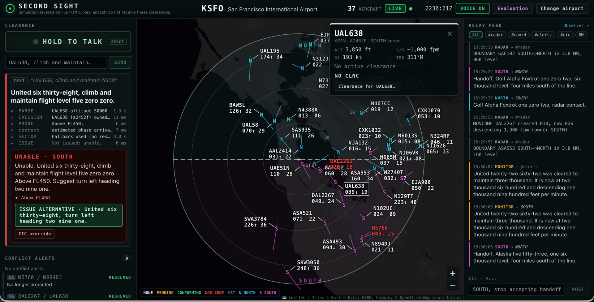
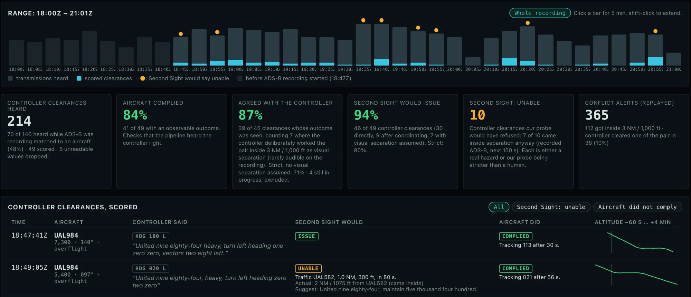

# Second Sight

**An AI co-controller that watches live air traffic, catches conflicts and bad clearances before they happen, and never goes off shift.**



| | |
|---|---|
| **What** | Two AI sector controllers (NORTH, SOUTH) work real ADS-B traffic at any US airport. They probe every clearance, watch whether aircraft conform, predict conflicts 2 minutes ahead, and hand off planes to each other. A human Controller-in-Charge talks to them by push-to-talk. |
| **Why** | In 2002 over Überlingen, one controller worked the airspace alone, the conflict alert was off and the phone line to the next center was dead: 71 people died. Today the US is ~1,600 controllers short of the FAA's own target. |
| **How** | **Terse Durable Actors** hold every plane's state, one call at a time. **Agent Relay** is the only line between the AI controllers. **Mastra** runs the agents. A **Superserve** sandbox transcribes real SFO radio so we can score ourselves against human controllers. |

> Simulation layered on live traffic. Real aircraft never receive these clearances.

## How it fits together



**Rule of the system:** math decides what's safe (separation, probes, conformance are plain tested code in `shared/`); the LLM agents only parse speech, choose among safe options, and coordinate.

## Demo

| Good clearance: issued, aircraft conforms | Bad clearance: probe says “Unable” + alternative |
|---|---|
| [](docs/pitch/assets/good.mp4) | [](docs/pitch/assets/bad.mp4) |
| “United twenty-two sixty-two, descend and maintain three thousand.” | “United six thirty-eight, climb and maintain flight level five zero zero.” |

Click a frame for the video. Pitch deck: [`docs/pitch/`](docs/pitch/) ([live slides](https://claude.ai/artifact/BhdkUkWUhKXqRbSvhD2goh)).

## Scored against real controllers

We transcribed 3 hours of real NorCal Approach radio at SFO, matched every clearance to the aircraft on ADS-B, and asked: what would Second Sight have ruled, and what did the plane actually do?



**87%** agreement with the human controller on clearances whose outcome we saw (71% on the strict count, without assuming visual separation). Open it locally at `http://localhost:5173/#/eval/KSFO`.

---

## Why (with sources)

Second Sight is meant to *assist* overloaded controllers with conformance monitoring, always-on conflict prediction, and automatic coordination between sectors. US radar systems already have conflict alerts; this is not a claim that any tool alone would have prevented the accidents below.

- **Überlingen, Germany, July 1, 2002 (71 killed).** One Zurich controller was working the whole airspace alone, the visual conflict alert was off for maintenance, and the phone line that an adjacent center used to try to warn him was down. Second Sight keeps conflict alerting on, puts an AI controller on every sector, and coordinates over a durable channel where a warning waits in the inbox instead of failing like a dead phone line. ([FAA lessons learned](https://www.faa.gov/lessons_learned/transport_airplane/accidents/RA-85816))
- **Washington DC (DCA), January 29, 2025 (67 killed).** PSA Airlines 5342 and an Army Black Hawk collided on approach to Runway 33. The NTSB cited helicopter routes placed too close to the approach path, altimeter errors, and controller workload; the helicopter route had a 200 ft altitude limit, and from Oct 2021 to Dec 2024 there were 15,214 close-proximity events between airliners and helicopters near DCA. Second Sight's conformance monitoring flags an aircraft above its altitude restriction, and continuous conflict alerting surfaces a pattern that repeats. ([NTSB final report coverage](https://www.globalair.com/articles/ntsb-releases-final-report-on-potomac-midair-collision/11956), [preliminary findings](https://theaviationist.com/2025/03/11/potomac-river-collision-preliminary-report/))
- **Staffing (2026).** About 10,968 certified professional controllers against an FAA target of 12,563 (cut from 14,633), with about 2.2 million overtime hours in 2024. The FAA's own plan relies on automation to help close the gap. ([AIN](https://backend.ainonline.com/aviation-news/air-transport/2026-05-18/faa-cuts-2000-certified-controller-goal-2026-plan))

## Architecture in detail

**Terse Durable Actors hold all state.** One `Airspace` actor owns the airport, traffic, track control, handoffs, conflict alerts, and feed; each aircraft with a clearance is an `Aircraft` actor with its own conformance timer. Actors process one call at a time, so an aircraft can never be under two sectors' control during a handoff. **The bridge** polls ADS-B every 5 s, pushes traffic to the actors, runs the deterministic conflict alert and boundary detection, and posts machine events to Agent Relay as `RADAR`. **Mastra runs the agents and the clearance pipeline:** NORTH, SOUTH, and MONITOR are Mastra agents (OpenAI models via the Mastra model router) in separate processes with typed tools over the actors; every clearance runs a Mastra workflow (parse → resolve → probe → sector review → result). **Agent Relay carries all coordination**: handoffs, APREQs, and alerts are Relay DMs and channel posts. Rules compute facts (geometry, separation, conformance, probes, track control are plain tested code in `shared/`); the LLM only parses speech and decides how to phrase and coordinate.

### The AI controllers ("You talk to the aircraft. Math guarantees separation. The AI does what a second controller does: chooses, remembers, and coordinates.")

- **Math answers "is it safe?"** Separation, probes, conformance, and every option the AI may pick are plain tested code in `shared/` (`generateCandidates`, `flightPhase`, `checkAgreements`, `recentConflictingClearance`, `sectorEntry`).
- **The AI answers "is it the right call?"** For each CIC clearance the owning sector agent gets a facts packet and must `submit_review`: **issue**, **unable** (choosing the best math-validated candidate by id, with a reason such as "keeps the departure climbing"), **confirm** (a contradicting clearance moments ago, or a coordination agreement the CIC may not know about), or **coordinate** (a point out to the other sector, issued only after "point out approved").
- **Memory lives in the actors:** APREQ plans and conditional handoffs become `agreements`; CIC instructions in `#cic` become `directives`. Agents get both in every decision.
- **Safety rule:** agents only pick candidate ids; tools and the workflow validate and re-probe. If an agent times out or returns something invalid, a deterministic fallback decides and says so (`review.by: "FALLBACK"`, posted to `#cic`). Protocol: [`docs/ai-protocol.md`](docs/ai-protocol.md).

## Run

Requires Bun 1.4.2+ and, on Windows, WSL 2 Ubuntu for the Terse local runtime. Copy `.env.example` to `.env` and set `OPENAI_API_KEY` (and `DEEPGRAM_API_KEY` for voice). `LLM_PROVIDER=anthropic` with `ANTHROPIC_API_KEY` switches the agents to Claude.

```powershell
wsl -d Ubuntu -u root -- bash scripts/actor-dev.sh   # Terse actors on :7100 (= `terse actor dev` in actor/)
bun run bridge                                       # HTTP API on :8787, ADS-B poller, RADAR on Relay
bun run agent NORTH                                  # sector controller agents (one terminal each)
bun run agent SOUTH
bun run agent MONITOR
bun run web                                          # UI on :5173
```

- `bun run backend` starts the bridge and all three agents in one terminal (prefixed logs).
- **Hosted actors (Terse platform):** `wsl -d Ubuntu -u root -- bash scripts/deploy-actors.sh` deploys `actor/` (it runs `scripts/sync-actor-shared.ts` first, because the deploy uploads only `actor/`). Then set `TERSE_ACTOR_URL=https://api.useterse.ai/cmvwv4a710119jy2aamkzrzfb/actors` and `TERSE_API_KEY` in `.env`; the WSL dev server is no longer needed.
- Frontend API contract: [`docs/API.md`](docs/API.md).
- AI behavior check (smart option, issue, confirm, coordinate/point out, say again, agreements): `bun scripts/ai-check.ts replay`.
- Record traffic for replay: `bun scripts/record.ts KSFO 20`; check a scenario offline: `bun scripts/scenario-offline.ts KSFO`.
- Unit tests: `bun test shared` (separation, probe, conformance, phraseology, telephony, airports).
- Backend check without a UI: `bun scripts/backend-check.ts`.
- Replay demo scenario (KSFO): `bun scripts/scenario-check.ts 3 120` runs it three times and prints the timeline.
- `CLEARANCE_MODE=direct bun run bridge` lets the probe decide clearances when the agent processes aren't running.

## Shadow evaluation (real controller vs Second Sight)

Open `http://localhost:5173/#/eval/KSFO` (or **Evaluation** in the header). For each clearance the real NorCal Approach
controller gave, it shows what Second Sight would have ruled at that moment of recorded traffic and what the aircraft
actually flew.

- **ADS-B recordings** for 18:47-20:32Z are committed in `data/recordings/KSFO/`.
- **Heard transmissions** (transcribed NorCal Approach audio from the LiveATC archive) are committed in
  `data/eval/KSFO/heard.jsonl`. The `EvalLog` actor is local SQLite, so the bridge loads this file automatically on the
  first `/eval` request (or run `bun run listener:import KSFO`). After re-transcribing, refresh it with
  `bun run listener:export KSFO`. The audio itself stays out of git.
- To rebuild from audio: put LiveATC archive MP3s in `data/recordings/KSFO/`, then
  `bun run listener backfill KSFO` (transcribes in a Superserve sandbox; needs `SUPERSERVE_API_KEY` and a
  `second-sight-openai` secret), `bun run listener pull KSFO`, `bun run listener:parse KSFO`.
